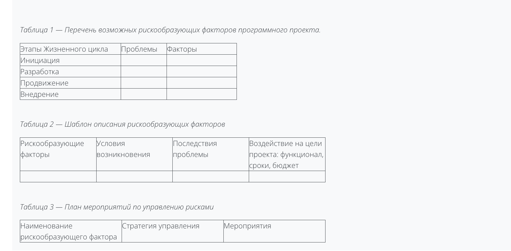

Проект выполняют три студента, у каждого своя роль

Лабораторная работа №1. Разработка концепции

В данной лабораторной работе формируется концепция и описываются три основных элемента: задачи проекта; объем проекта; команду, ответственную за реализацию проекта.

Порядок выполнения работы:

Сформировать команду (3-7 человек);
Методом мозгового штурма сформулировать тему проекта и его основные идеи и цели;
Провести анализ перспективности темы проекта;
Подготовить отчет по лабораторной работе.
Отчет по лабораторной работе должен содержать:

Титульный лист;
Полное название проекта;
Основную идею проекта;
Цели и задачи проекта;
Краткое описание функционала и архитектуры;
Целевую аудиторию;
План-минимум и план-максимум;
Состав команды, распределение ролей;
Предполагаемые сроки работы над проектом;
Возможные затраты ресурсов.

Лабораторная работа №2. Оценка перспективности концепции
Требуемые условия завершения
Надо сделать: Дать ответ на задание Надо сделать: Получить оценку
Открыто с: четверг, 1 сентября 2022, 00:00
В данной лабораторной работе проводится подробный анализ перспективности концепции проекта.

Порядок выполнения работы:

Обозначить необходимость и/или потребность рынка в разрабатываемом продукте;
Провести подробный анализ целевой аудитории и основных проблем, которые могут быть решены разработкой продукта;
Провести анализ конкурентов (при их наличии) и сравнить по ключевым критериям со своим продуктам;
Сделать выводы об эффективности разрабатываемого продукта.
Отчет по лабораторной работе должен содержать:

Титульный лист;
Описание основной целевой аудитории;
Проблемы, решаемые разработкой продукта;
Анализ конкурентов;
Сравнительную таблицу конкурентов;
Выводы (полезный эффект от разработки продукта).

Лабораторная работа №3. Модели жизненного цикла проекта
Требуемые условия завершения
Надо сделать: Дать ответ на задание Надо сделать: Получить оценку
Открыто с: четверг, 1 сентября 2022, 00:00
В данной лабораторной работе выбирается модель жизненного цикла для последующей разработки.

Порядок выполнения работы:

Ознакомиться с различными моделями жизненного цикла и методиками их выбора;
Проанализировать концепцию проекта и определить основные характеристики разработки;
На основании определенных характеристик выбрать подходящую модель жизненного цикла.
Отчет по лабораторной работе должен содержать:

Титульный лист;
Описание основных характеристик разработки;
Сравнение моделей жизненного цикла по выбранным характеристикам;
Выводы.
Определение основных характеристик возможно по следующим направлениям: особенности процесса выявления требований, квалификация команды, сложность проекта и т.д.

Для сравнения моделей жизненного цикла по выбранным характеристикам необходимо построить сравнительную таблицу (см. пример):

Характеристики программного проекта

 	
Наличие в модели
Каскадная
 Спиральная	
Итерационная
Инкрементная
V-образная
RAD-модель

В выводах необходимо привести краткое описание выбранной модели, ее преимущества и недостатки для проекта, а также обоснование целесообразности использования.

Лабораторная работа №4. Инициализация проекта
Требуемые условия завершения
Открыто с: четверг, 1 сентября 2022, 00:00
В данной лабораторной работе выполняется инициация проекта и планирование основных задач по проекту.

Порядок выполнения работы:

Составить полный перечень задач, которые необходимо выполнить по проекту;
Упорядочить задачи;
Распределить задачи между всеми участниками проекта;
Указать взаимосвязь задач (какие задачи должны завершиться, прежде чем начнутся другие, какие задачи начнутся или завершатся одновременно и т.д.);
Оценить временные затраты на каждую задачу.
Отчет по лабораторной работе должен содержать:

Титульный лист;
Список задач с указанием взаимосвязей, ответственных за задачи и временными затратами.
Выводы.

Лабораторная работа №5. Календарный план проекта
Требуемые условия завершения
Открыто с: четверг, 1 сентября 2022, 00:00
В данной лабораторной работе выполняется формирование календарного плана проекта.

Порядок выполнения работы:

На основании полного списка задач, составленного в лабораторной работе №4, определить длительность выполнения каждой работы.
Построить сетевой график.
Построить диаграмму Ганта.
Отчет по лабораторной работе должен содержать:

Титульный лист;
Сетевой график.
Диаграмму Ганта
Выводы.

Лабораторная работа №6. Инструментальные средства управления проектами
Требуемые условия завершения
Открыто с: четверг, 1 сентября 2022, 00:00
В данной лабораторной работе выполняется подбор инструмента управления проектом.

Порядок выполнения работы:

Выбрать 3-5 распространенных инструментов планирования и управления задачами и сравнить их по 5 критериям.
Выбрать 3-5 распространенных инструментов для организации коммуникации в команде и сравнить их по 3 критериям.
Обосновать выбор инструментов.
Представить скриншоты работы с выбранными инструментами.
Отчет по лабораторной работе должен содержать:

Титульный лист;
Анализ инструментов планирования и управления задачами;
Анализ инструментов для организации коммуникации в команде;
Итоги работы с выбранными инструментами (скриншоты);
Выводы.

Лабораторная работа №7. Оценка рисков проекта 

Открыто с: четверг, 1 сентября 2022, 00:00
В данной лабораторной работе выполняется анализ рисков проекта.

Порядок выполнения работы:

Выбрать и обосновать возможные рискообразующие факторы.
Перечислить и описать проблемы, которые могут возникнуть на каждом этапе жизненного цикла выполнения проекта.
С учетом выделенных проблем обосновать перечень возможных рискообразующих факторов, которые могут возникнуть на каждом этапе жизненного цикла выполнении проекта. Результаты представить в виде таблицы 1.
Описать по схеме «условия возникновения | последствия проявления | влияние на результат» множество рискообразующих факторов, обуславливающих возникновение рисков проекта. Результаты представить в виде таблицы 2.
Выбрать стратегии реагирования на рискообразующие факторы, предложить комплекс мероприятий для каждого из них. Результаты представить в виде таблицы 3.
Отчет по лабораторной работе должен содержать:

Титульный лист;
Возможные рискообразующие факторы;
Описание рискообразующих факторов;
План мероприятий по управлению рисками;
Выводы.

ТАКЖЕ ЕСТЬ 2 КОНТРОЛЬНЫЕ ТОЧКИ

Контрольная точка №1 
Отчет с индивидуальным прогрессом по проекту, который должен содержать:

Список задач участника проекта согласно графику работ, которые необходимо реализовать к указанному сроку;
Результаты выполнения задач (листинги, схемы, макеты и т.п.)

Контрольная точка №2
Отчет с индивидуальным прогрессом по проекту, который должен содержать:

Список задач участника проекта согласно графику работ, которые необходимо реализовать к указанному сроку;
Результаты выполнения задач (листинги, схемы, макеты и т.п.)
